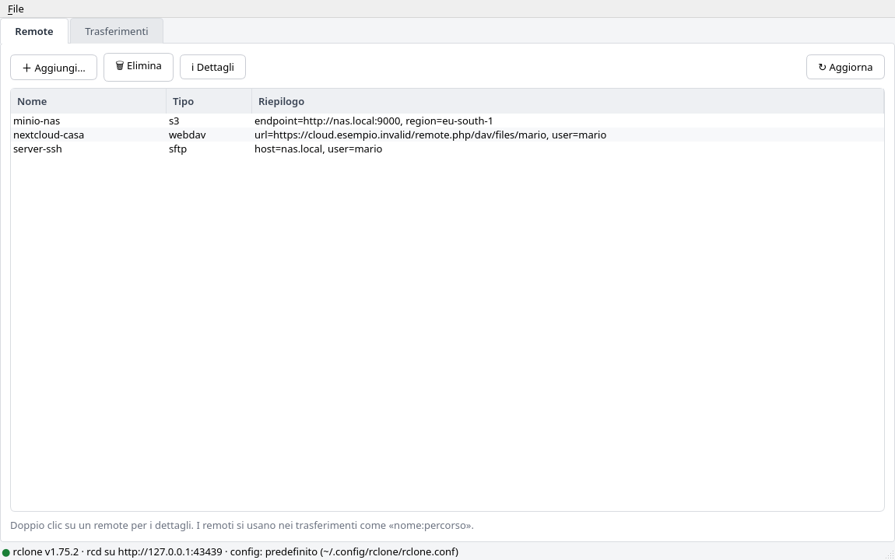
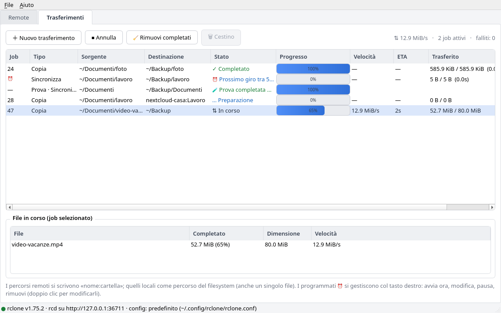
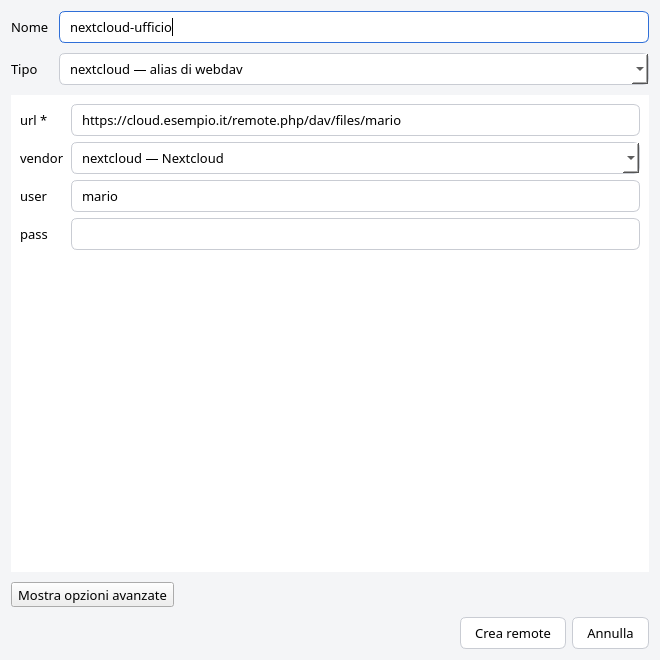
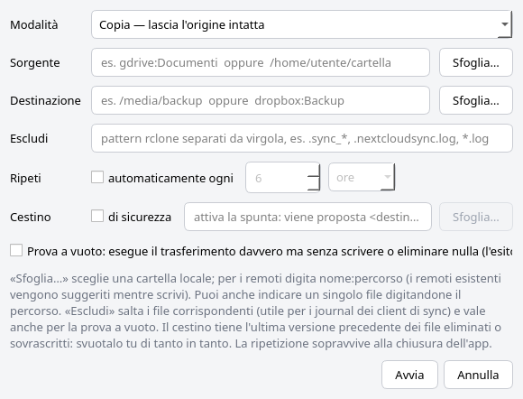

<p align="center">
  <a href="README.md"></a>
</p>

# Clonaut

*Il pilota grafico per rclone.*

Interfaccia grafica desktop (Qt: PySide6 o PyQt6) per [rclone](https://rclone.org), costruita
sopra la REST API di `rclone rcd`: l'app avvia da sola un demone rclone locale e lo
pilota via HTTP con `requests`. Il backend è rclone stesso — la GUI è solo l'interfaccia.

L'interfaccia è in **italiano** e in **inglese**: segue la lingua del sistema
(italiano se il sistema è in italiano, altrimenti inglese); in
**File → Impostazioni…** se ne può scegliere una, e `CLONAUT_LANG=it|en` vale
su entrambe.

**Funzioni:**

- **Remote** — elenco con tipo e riepilogo, creazione con form dinamico generato dai
  ~58 provider noti (`config/providers`), eliminazione, dettagli della config.
- **Trasferimenti** — coda job con barre di avanzamento, velocità, ETA, byte
  trasferiti, annullamento, pannello «File in corso» del job selezionato.
  Modalità **Copia / Sposta / Sincronizza**, tra remoti, locali o misti.
- **Esclusioni** — pattern rclone per job (es. journal dei client di sync).
- **Cestino di sicurezza** — i file che verrebbero **eliminati o sovrascritti**
  in destinazione vengono spostati in una cartella cestino (con il loro
  percorso) invece di sparire. Si consulta dalla GUI: pulsante **🗑 Cestino**
  (o tasto destro sulla riga) apre il visualizzatore con la lista dei file,
  «Apri nel gestore file» e «Svuota cestino». Il cestino tiene l'ultima
  versione precedente di ciascun file: svuotalo tu di tanto in tanto.
- **Tray e impostazioni** — icona nella tray (clic per mostrare/nascondere, esci, tooltip
  con i trasferimenti attivi). Menu **File → Impostazioni…**: chiudi/minimizza
  nella tray, avvio ridotto nella tray, notifiche a fine trasferimento e
  lingua dell'interfaccia (`~/.config/clonaut/settings.json`). Se l'ambiente non ha tray
  (es. GNOME senza estensione), l'app funziona come prima.
- **Prova a vuoto** — anteprima onesta: gira su un processo rclone avviato con
  `--dry-run`, impossibile che scriva o elimini; mostra file/byte che
  sarebbero stati trasferiti e quanti file verrebbero eliminati.
- **Ripetizione automatica ⏰** — i trasferimenti si possono ripetere ogni N
  minuti/ore/giorni: la programmazione sopravvive alla chiusura dell'app
  (`~/.config/clonaut/recurring.json`), con modifica (doppio clic sulla
  riga), pausa/riattivazione e "avvia ora" dal tasto destro. *I giri partono solo con l'app aperta: se era
  chiusa, alla riapertura parte subito un giro se l'intervallo è scaduto.*






## Esempio: tenere allineato Nextcloud → kDrive

Obiettivo: rendere specchiati i contenuti di `~/Nextcloud`
(sincronizzata dal client Nextcloud) su `~/kDrive/Nextcloud`
(sincronizzata dal client kDrive). La "verità" resta Nextcloud; kDrive ne è lo
specchio:

1. **Prova a vuoto** — Trasferimenti → ＋ Nuovo trasferimento → Sincronizza,
   sorgente `~/Nextcloud`, destinazione
   `~/kDrive/Nextcloud`, Escludi:
   `.sync_*, .nextcloudsync.log, .lock, .resource, .sync`, cestino
   `~/kDrive/Nextcloud-cestino`, spunta *Prova a
   vuoto* → guarda l'esito in coda («Prova»).
2. **Programmazione** — stessa configurazione senza la prova, con *Ripeti
   automaticamente ogni 6 ore* (o la frequenza che preferisci) → la riga ⏰
   si occupa di tutto; tasto destro per pausa o rimozione.

I pattern suggeriti saltano i journal interni del client Nextcloud (`.sync_*.db`,
`.nextcloudsync.log`) e i file di blocco che cambiano di continuo. Con il
cestino attivo anche le cancellazioni sono reversibili; se il cestino sta
dentro la cartella sincronizzata da kDrive (come nel predefinito), viene
caricato anche sul cloud kDrive — recuperabile anche se il disco si rompe.
Attenzione: il sync elimina in destinazione ciò che sparisce dall'origine —
con il cestino finisce lì invece che nel nulla.

## Installazione (.deb)

Il modo più semplice: scarica `clonaut_<versione>_all.deb` dall'ultima
[release](https://github.com/gradia64/Clonaut/releases/latest) e installalo con

```bash
sudo apt install ./clonaut_0.3.1_all.deb
```

Oppure costruisci il pacchetto dai sorgenti con lo script incluso (richiede `dpkg-deb`):

```bash
./build-deb.sh                       # → build/clonaut_0.3.1_all.deb
sudo apt install ./build/clonaut_0.3.1_all.deb
```

Il pacchetto installa:
- `/usr/share/clonaut/` — l'applicazione (sorgenti Python, GPL-3)
- `/usr/bin/clonaut` — comando da terminale
- voce «Clonaut» nel menu delle applicazioni (`io.github.gradia64.Clonaut.desktop`),
  icone, metadati AppStream per i software center e pagina man (`man clonaut`)

Dipendenze dichiarate: `python3`, `python3-requests`, `python3-pyqt6`, `rclone`
(l'app usa PySide6 se presente sul sistema, altrimenti PyQt6 — il codice è
scritto per entrambi). Disinstallazione: `sudo apt remove clonaut`.
Ricompilazione dopo modifiche: `./build-deb.sh` (metadati in `packaging/`;
per personalizzare il campo Maintainer: `MAINTAINER="Nome <email>" ./build-deb.sh`).

## Installazione (Arch Linux, AUR)

Dalla versione 0.4.0 Clonaut è su AUR, con qualsiasi helper AUR:

```bash
yay -S clonaut        # ultima release
yay -S clonaut-git    # ultimo commit su main
```

I file di pacchettizzazione e le note per il manutentore sono in
[`packaging/aur/`](packaging/aur/).

## Installazione (AppImage, ogni distribuzione)

Da 0.4.0 ogni release ha un'AppImage per **x86_64** e **aarch64** (ARM64):
un solo file con dentro Python, Qt (PyQt6) e una copia di rclone, niente da
installare.

```bash
chmod +x Clonaut-0.4.1-x86_64.AppImage
./Clonaut-0.4.1-x86_64.AppImage
```

- **Requisiti:** glibc 2.34 o successiva su x86_64 (Debian 12, Ubuntu 22.04,
  Fedora 35 o più recenti), 2.39 su aarch64 (Debian 13, Ubuntu 24.04). FUSE
  non serve (runtime statico). Le librerie di base del desktop vengono dal
  sistema, come in ogni AppImage: X11 o Wayland, GL, fontconfig,
  `libxkbcommon` e `libxkbcommon-x11`, D-Bus, GLib — ogni desktop le ha.
- **rclone:** la copia inclusa (ora la 1.76.0) è solo di riserva. Se `rclone`
  è installato nel sistema, o indicato nelle impostazioni, si usa quello (vedi
  [Quale rclone viene usato](#quale-rclone-viene-usato)).
- **Aggiornamenti:** l'AppImage contiene le informazioni di aggiornamento,
  quindi [Gear Lever](https://flathub.org/apps/it.mijorus.gearlever) o
  AppImageUpdate la aggiornano sul posto dalle release di GitHub.
- L'icona nella tray richiede lo stesso supporto del desktop degli altri
  pacchetti (un'estensione AppIndicator su GNOME).

Per costruirla (su x86_64, anche quella aarch64; ogni download è fissato con
lo SHA-256):

```bash
./build-appimage.sh                  # → dist/Clonaut-<versione>-x86_64.AppImage (+ .zsync)
./build-appimage.sh aarch64          # → dist/Clonaut-<versione>-aarch64.AppImage
packaging/appimage/smoke-test.sh dist/Clonaut-<versione>-x86_64.AppImage
packaging/appimage/test-distros.sh dist/Clonaut-<versione>-x86_64.AppImage   # Docker
```

## Verificare una release

Da 0.4.0 ogni tag di rilascio `vX.Y.Z` è firmato con la **chiave di rilascio
di Clonaut**, una chiave OpenPGP che non lascia mai la macchina del maintainer:

- primaria `9F54 724A CD09 95BE C321  BD30 E6C5 DCC0 D49C CC6B` (solo certificazione)
- sottochiave dei tag `CEAC C8CA 966C 2A16 B7E8  07DB 5B8D 6236 E772 8ED4`

La chiave pubblica è [`packaging/clonaut-release-key.asc`](packaging/clonaut-release-key.asc).
Il pacchetto AUR `clonaut` si costruisce dal tag firmato e `makepkg` ne
verifica la firma (`validpgpkeys`). Per verificare un tag a mano:

```bash
scripts/verify-tag.sh v0.4.1
```

Usa un portachiavi temporaneo con la sola chiave pubblica e accetta il tag
solo se l'ha firmato la sottochiave dei tag. I file delle release (`.deb`,
AppImage) li costruisce GitHub Actions dal tag, con `SHA256SUMS` e
un'attestazione di provenienza:

```bash
sha256sum -c SHA256SUMS --ignore-missing
gh attestation verify Clonaut-0.4.1-x86_64.AppImage -R gradia64/Clonaut
```

## Requisiti

- Linux, Python ≥ 3.10
- [PySide6](https://pypi.org/project/PySide6/) e `requests` oppure PyQt6, e `requests`
  (vedi `requirements.txt`)
- `rclone` (testato con v1.75.2 e v1.76.0)

### Quale rclone viene usato

Clonaut cerca il programma `rclone` in quest'ordine e usa il primo che trova:

1. la variabile d'ambiente `CLONAUT_RCLONE` (percorso completo);
2. il percorso impostato in **File → Impostazioni… → Programma rclone**;
3. `rclone` nel `PATH`;
4. la copia inclusa nell'AppImage, solo come ultima risorsa.

La finestra **Aiuto → Informazioni su Clonaut** mostra il percorso in uso.

## Avvio

```bash
./run.sh                    # oppure: python3 main.py  /  python3 -m clonaut
```

Oppure installalo come pacchetto Python (il binding Qt si sceglie con un
extra, oppure con `--system-site-packages` si riusa quello della distribuzione):

```bash
python3 -m venv .venv && .venv/bin/pip install ".[pyqt6]"
.venv/bin/clonaut
```

Il binding Qt è PySide6 se presente, altrimenti PyQt6; con
`CLONAUT_QT=pyqt6` (o `pyside6`) lo scegli tu.

All'avvio l'app:

1. sceglie una porta libera su 127.0.0.1 e genera credenziali casuali;
2. avvia `rclone rcd` come processo figlio (muore con la GUI, grazie a PR_SET_PDEATHSIG);
3. apre la finestra e inizia il polling dello stato (≈1 volta al secondo).

Opzioni:

```bash
clonaut --config /percorso/rclone.conf   # usa un file di config specifico
clonaut --port 5572                      # porta fissa per il rcd locale

# aggancio a un rclone rcd già avviato altrove (non viene avviato nessun processo):
CLONAUT_RC_PASS=segreta clonaut --url http://127.0.0.1:5572 --user utente
# senza CLONAUT_RC_PASS la password rc viene chiesta nel terminale;
# --password funziona ancora, ma ogni utente della macchina la legge con `ps`
```

## Come si usa

- **Tab Remote** — «＋ Aggiungi…» apre un form costruito sui campi reali del backend
  scelto (i campi obbligatori sono marcati con `*`, i predefiniti appaiono come
  segnaposto, le scelte a numero chiuso come `vendor` sono menu a tendina, le
  opzioni avanzate sono nascoste dietro un pulsante). Il menu **Tipo** include
  alias comuni che rclone non espone: cercando **nextcloud** (o owncloud, gdrive,
  ssh…) si arriva al backend giusto e i campi corrispondenti si preselezionano da
  soli. «Elimina» rimuove solo la voce di configurazione, **non** tocca i dati.
  Doppio clic = dettagli (i valori sensibili sono mascherati con `XXX` da rclone).
- **Nextcloud in due passi** — Tipo «nextcloud», poi URL
  `https://tuoserver/remote.php/dav/files/NOMEUTENTE`, utente e password (meglio
  una *password per app* creata dalle impostazioni di Nextcloud): il campo
  vendor è già impostato su «Nextcloud».
- **Tab Trasferimenti** — «＋ Nuovo trasferimento»: sorgente e destinazione possono
  essere `nome-remote:percorso` oppure percorsi locali (anche un singolo file);
  «Sfoglia…» sceglie cartelle locali. I remoti esistenti vengono suggeriti mentre
  digiti. Il campo **Escludi** accetta pattern rclone separati da virgola (es.
  `.sync_*, .nextcloudsync.log, *.log`). «Sposta» e «Sincronizza» chiedono
  conferma esplicita perché eliminano file.
- **Prova a vuoto** — il checkbox esegue il trasferimento identico (stessi filtri
  e stesso cestino) su un processo dedicato con `--dry-run`: l'esito — «N file,
  X MiB, M da eliminare in Ys» — appare in coda marcato «Prova», senza che nessun file venga
  toccato.
- **Cestino di sicurezza** — spunta «Cestino» nel dialog: viene proposta
  `<destinazione>-cestino` (modificabile; **non** dentro la destinazione).
  Con la spunta attiva, i file eliminati o sovrascritti dal sync finiscono
  lì invece di essere cancellati. Li vedi col pulsante **🗑 Cestino** della
  coda (attivo sulle righe che hanno un cestino: trasferimenti, prove e
  programmati ⏰) o col tasto destro sulla riga.
- **Tray** — chiudi (o minimizza) la finestra: resta solo l'icona nella tray e
  i giri ⏰ continuano; un clic sull'icona la riporta in primo piano (un
  altro clic la nasconde). *Esci* (menu File
  o menu della tray) chiude davvero l'app e ferma il suo rclone rcd.
- **Ripeti automaticamente** — spunta «Ripeti ogni N ore/minuti/giorni»: nasce una
  riga ⏰ in coda che si rilancia da sola a ogni intervallo (mai in parallelo).
  Tasto destro sulla riga: *Avvia ora*, *Modifica…*, *Metti in pausa/Riattiva*,
  *Rimuovi programmazione*. La modifica (anche con doppio clic sulla riga)
  cambia percorsi, modalità, esclusioni, cestino e intervallo; un giro già in
  corso prosegue con le impostazioni precedenti e le modifiche valgono dal
  giro successivo.
- **Aiuto → Informazioni su Clonaut** mostra le versioni di Clonaut, rclone,
  Qt e Python e dove l'app tiene i suoi dati.
- **Annulla** ferma il job selezionato (i file già trasferiti restano dove sono);
  «🧹 Rimuovi completati» pulisce la vista (le righe ⏰ restano).
- **Sincronizza** rende la destinazione *identica* alla sorgente: i file presenti
  solo in destinazione vengono eliminati, anche se corrispondono ai pattern di
  esclusione (verificato su rclone 1.75).

## Note e limiti

- **OAuth** (Google Drive, Dropbox, OneDrive…): il consenso richiede un browser.
  Crea il remote e completa l'accesso da terminale con
  `rclone authorize "<tipo>"`, poi incolla il token JSON nel campo «token».
- **Modifica di un remote esistente** non è inclusa di proposito: rclone maschera i
  segreti, quindi riscriverli li corromperebbe. Usa `rclone config` (o ricrea il remote).
- Un trasferimento avviato **fuori** dalla GUI viene mostrato solo mentre ha file in
  corso (rilevato dalle stats aggregate); a processo finito sparisce dalla coda.
- «Sincronizza» su file singolo non è consentita (lo stesso rclone lo richiede:
  sync/move operano su cartelle); per un file usa «Copia».
- Non c'è pausa/ripresa del singolo job (rclone non la espone via rc) né
  limitazione di banda dalla GUI (si può avviare rcd con `--bwlimit` esternamente
  in modalità `--url`).

## Sicurezza

- Il demone `rclone rcd` resta **solo su 127.0.0.1** con credenziali casuali
  usa-e-getta (HTTP Basic); nessuna porta esposta sulla rete.
- Le credenziali del demone passano per variabili d'ambiente
  (`RCLONE_RC_USER`/`RCLONE_RC_PASS`), non per la riga di comando: non sono
  visibili ad altri utenti con `ps`.
- Il log del demone finisce in `~/.cache/clonaut/rcd-<porta>.log` (contiene le
  righe di attività di rclone, non le password); i log più vecchi di 7 giorni
  vengono rimossi automaticamente.
- Chi aggiorna dalla versione chiamata «GUI rclone» ritrova impostazioni e
  programmazioni: al primo avvio vengono copiate da `~/.config/rclone-gui/`.

## Struttura

```
pyproject.toml              metadati del pacchetto Python (comando `clonaut`)
main.py, run.sh             avvio dai sorgenti
build-deb.sh                costruisce il .deb
build-appimage.sh           costruisce le AppImage (x86_64, aarch64)
scripts/                    impronte della chiave di rilascio, verifica dei tag, note di rilascio, invio all'AUR dalla macchina del maintainer
.github/workflows/          CI (test, metadati, .deb) e build delle release (+ prova del pacchetto AUR)
packaging/                  .desktop, metadati AppStream, icone, file Debian, pagina man
tests/                      suite pytest (rclone vero, Qt offscreen)
clonaut/
├── app.py                  avvio: argomenti CLI, QApplication, demone rclone
├── api.py                  client REST (Basic auth, endpoint config/sync/job/stats/list/purge)
├── rcd.py                  ricerca di rclone, processo `rclone rcd` (porta, credenziali, log)
├── worker.py               thread di polling (watch-list) + DryRunWorker
├── appctx.py               contesto condiviso (+ backend dedicato alle prove)
├── settings.py             impostazioni persistenti (tray, notifiche)
├── qtcompat.py             import Qt: PySide6 o PyQt6 (`CLONAUT_QT`)
├── i18n.py                 lingua dell'interfaccia: `tr()`, cataloghi gettext letti come .po
├── locale/en.po            traduzione inglese (i testi originali sono in italiano)
├── util.py                 formattazioni (size/ETA), QSS globale, icona
└── ui/
    ├── main_window.py      finestra, tab, tray, menu File→Impostazioni, status bar
    ├── remotes_tab.py      elenco remote + dettagli
    ├── remote_dialog.py    form dinamico da config/providers (+ alias, menu enum)
    ├── transfers_tab.py    coda trasferimenti, progressi, programmati ⏰, pulsante cestino
    ├── transfer_dialog.py  dialog nuovo trasferimento (esclusioni, cestino, ripetizione)
    ├── trash_dialog.py     visualizzatore del cestino (lista, apri, svuota)
    └── settings_dialog.py  impostazioni tray, notifiche, percorso di rclone e lingua
```

## Dettagli tecnici curiosi

- In rclone **ogni chiamata rc crea un job**, compresi `job/status` e `core/stats`:
  usare `job/list` come fonte della coda farebbe esplodere l'elenco con le chiamate
  di polling stesso. Il worker usa una *watch-list*: i job avviati dalla GUI, quelli
  trovati al primo avvio (validati per scartare il rumore interno) e i job esterni
  scoperti mentre trasferiscono.
- Le statistiche di un job vivono nel gruppo `job/<id>` e sopravvivono al termine:
  la lettura finale dà il 100% esatto anche a job già conclusi.
- `sync/copy` via API accetta solo filesystem di directory (a differenza del CLI):
  i file singoli locali passano per `operations/copyfile` con `_async: true`.
- `config/providers` non espone alias di backend (Nextcloud non esiste come tipo:
  è webdav con `vendor=nextcloud`); gli alias comuni sono mantenuti nel dialog.
- Le esclusioni per-job passano dal blocco `_filter: {ExcludeRule: [...]}` e il
  cestino da `_config: {BackupDir: ...}`; i parametri `_exclude`,
  `_filters-exclude`, `_filter.BackupDir` e `_dry_run` di rc sono ignorati
  da rclone 1.75 e 1.76 (verificati uno a uno; `_dry_run` è ignorato sia nelle
  chiamate sincrone sia in quelle `_async`: il sync scrive davvero).
- Per questo le prove a vuoto girano su un secondo `rclone rcd`, avviato al
  primo utilizzo con `--dry-run` globale: la prova non può alterare nessun file.
- Le programmazioni ⏰ vivono in `~/.config/clonaut/recurring.json`
  (override per test: env `CLONAUT_CONFIG_HOME`) e vengono riavviate dal
  timer della GUI: l'app deve restare aperta (anche solo nella tray) perché i
  giri partano.

## Test

```bash
python3 -m pytest                    # binding Qt scelto automaticamente
CLONAUT_QT=pyqt6 python3 -m pytest   # di nuovo con l'altro binding
```

La suite gira senza schermo (Qt `offscreen`) con un **rclone vero** e una
configurazione vuota e isolata in una cartella temporanea; i test che hanno
bisogno di rclone vengono saltati se non è installato. Coprono: ricerca di
rclone, impostazioni e migrazione, trasferimenti veri (copia, sync, file
singolo) con esclusioni e cestino, prove a vuoto, coda, programmazioni ⏰ e
loro modifica, dialog, tray ed entrambi i binding Qt.

## Contribuire

Segnalazioni e pull request sono benvenute su
[GitHub](https://github.com/gradia64/Clonaut/issues). Tradurre l'interfaccia
in una nuova lingua è un ottimo primo contributo:

1. aggiungi il codice della lingua e il suo nome a `LANGUAGES` in
   `clonaut/i18n.py`;
2. lancia `python3 scripts/update-po.py`: crea `clonaut/locale/<codice>.po`
   con tutti i testi dell'interfaccia;
3. compila le righe `msgstr` (i `msgid` sono gli originali italiani; `en.po`
   è un buon riferimento), lasciando i `{segnaposto}` come sono;
4. provala con `CLONAUT_LANG=<codice> clonaut` e `python3 -m pytest`.

Quando un testo nel codice cambia, `scripts/update-po.py` aggiorna tutti i
cataloghi ed elenca cosa resta da tradurre.

## Licenza

GPL-3: vedi `/usr/share/common-licenses/GPL-3` su Debian o
<https://www.gnu.org/licenses/gpl-3.0.html>.
