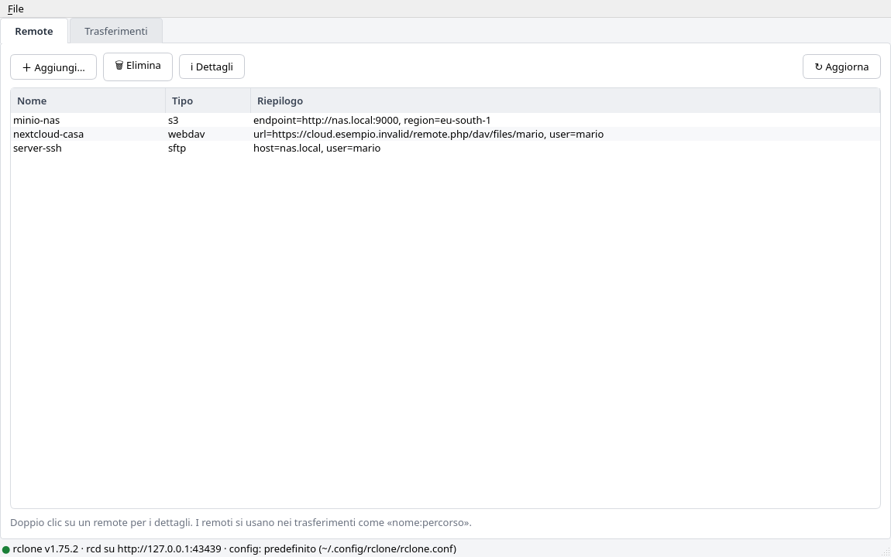
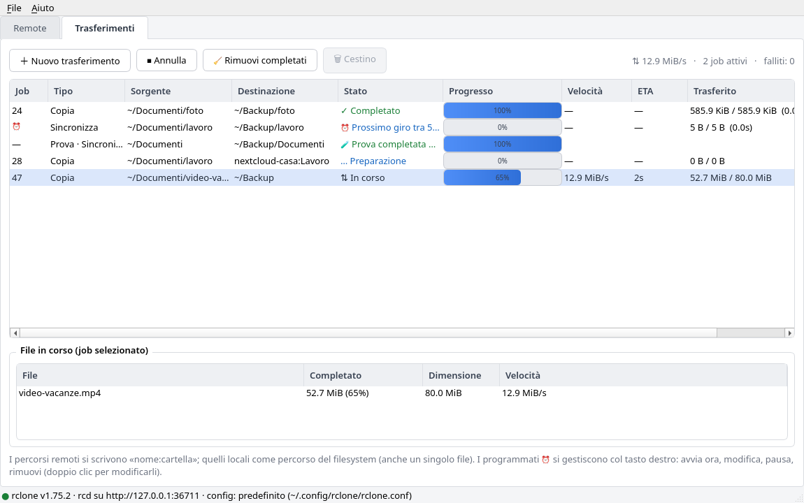
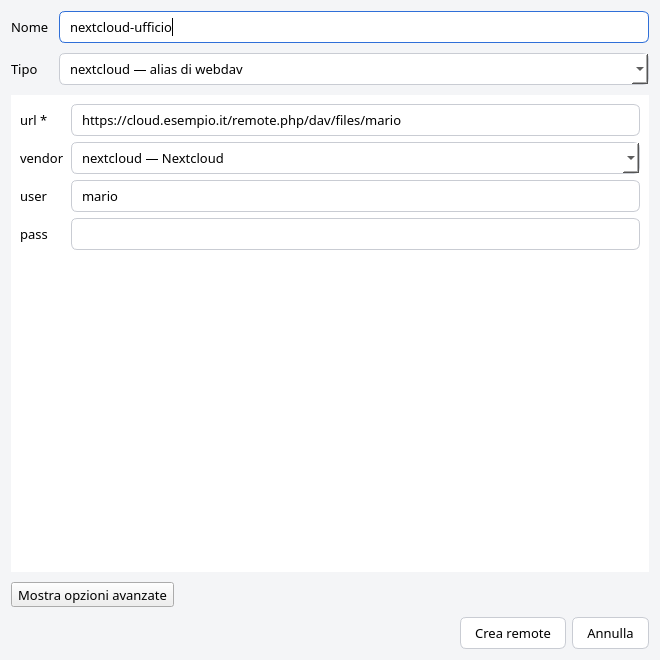
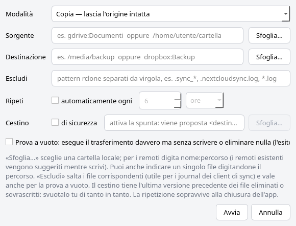

# Clonaut

**English** · [Italiano](README.it.md)

*The graphical pilot for rclone.*

Clonaut is a desktop GUI (Qt: PySide6 or PyQt6) for [rclone](https://rclone.org),
built on top of the `rclone rcd` REST API: the app starts its own local rclone
daemon and drives it over HTTP. rclone does all the real work — Clonaut is just
the cockpit.

> **Note:** the user interface is currently in **Italian**. Translations are
> welcome — see [Contributing](#contributing).

**Features:**

- **Remotes** — list with type and summary; create remotes through a dynamic
  form generated from rclone's ~58 known providers (`config/providers`); delete;
  view configuration details.
- **Transfers** — job queue with progress bars, speed, ETA, bytes transferred,
  cancel, and a "files in progress" panel for the selected job.
  **Copy / Move / Sync** between remotes, local paths, or a mix of both.
- **Exclusions** — per-job rclone patterns (e.g. sync-client journals).
- **Safety trash** — files that would be **deleted or overwritten** at the
  destination are moved to a trash folder (keeping their path) instead of
  disappearing. Browse it from the GUI: the **🗑 Cestino** (Trash) button, or a
  right-click on the row, opens a viewer with the file list, "open in file
  manager" and "empty trash". The trash keeps the latest previous version of
  each file: empty it from time to time.
- **Tray and settings** — tray icon (click to show/hide, quit, tooltip with
  active transfers). **File → Impostazioni…** (Settings): close/minimize to
  tray, start minimized to tray, notifications when a transfer finishes
  (`~/.config/clonaut/settings.json`). Without a system tray (e.g. GNOME without
  an extension) the app works as a normal window.
- **Dry run** — an honest preview: it runs on a separate rclone process started
  with `--dry-run`, so it cannot write or delete anything. It shows how many
  files/bytes would be transferred and how many files would be deleted.
- **Scheduled repeats ⏰** — transfers can repeat every N minutes/hours/days.
  Schedules survive restarts (`~/.config/clonaut/recurring.json`) and can be
  edited (double-click the row), paused, resumed or started immediately from
  the right-click menu. *Runs only
  happen while the app is open (the tray is enough); if the interval expired
  while it was closed, a run starts right away on the next launch.*






## Example: mirroring Nextcloud → kDrive

Goal: keep `~/Nextcloud` (synced by the Nextcloud client) mirrored to
`~/kDrive/Nextcloud` (synced by the kDrive client). Nextcloud stays the source
of truth; kDrive is the mirror:

1. **Dry run** — Trasferimenti (Transfers) → ＋ Nuovo trasferimento (New
   transfer) → Sincronizza (Sync), source `~/Nextcloud`, destination
   `~/kDrive/Nextcloud`, exclude
   `.sync_*, .nextcloudsync.log, .lock, .resource, .sync`, trash
   `~/kDrive/Nextcloud-cestino`, tick *Prova a vuoto* (dry run) → check the
   result in the queue (row marked «Prova»).
2. **Schedule** — same settings without the dry run, ticking *Ripeti
   automaticamente ogni 6 ore* (repeat every 6 hours) → the ⏰ row takes care of
   everything; right-click to pause or remove it.

The suggested patterns skip the Nextcloud client's internal journals
(`.sync_*.db`, `.nextcloudsync.log`) and lock files that change constantly.
With the trash enabled, deletions are reversible too; if the trash lives inside
the folder synced by kDrive (as in the default), it is uploaded to kDrive as
well — recoverable even if your disk dies. Remember: sync deletes at the
destination whatever disappears from the source — with the trash it ends up
there instead of nowhere.

## Installation (.deb)

The easiest way: download `clonaut_<version>_all.deb` from the latest
[release](https://github.com/gradia64/Clonaut/releases/latest) and install it:

```bash
sudo apt install ./clonaut_0.3.1_all.deb
```

Or build the package from source with the included script (requires `dpkg-deb`):

```bash
./build-deb.sh                       # → build/clonaut_0.3.1_all.deb
sudo apt install ./build/clonaut_0.3.1_all.deb
```

The package installs:
- `/usr/share/clonaut/` — the application (Python sources, GPL-3)
- `/usr/bin/clonaut` — command-line launcher
- a «Clonaut» entry in the application menu (`io.github.gradia64.Clonaut.desktop`),
  icons, AppStream metadata for software centers and a man page (`man clonaut`)

Declared dependencies: `python3`, `python3-requests`, `python3-pyqt6`, `rclone`
(the app uses PySide6 if available, otherwise PyQt6 — the code supports both).
It replaces the older `gui-rclone` package. Uninstall with
`sudo apt remove clonaut`. To set the Maintainer field when rebuilding:
`MAINTAINER="Name <email>" ./build-deb.sh`.

## Installation (Arch Linux, AUR)

From version 0.4.0 Clonaut is on the AUR, with any AUR helper:

```bash
yay -S clonaut        # latest release
yay -S clonaut-git    # latest commit on main
```

The packaging files and the maintainer notes are in
[`packaging/aur/`](packaging/aur/).

## Installation (AppImage, any distribution)

From version 0.4.0 every release has an AppImage for **x86_64** and
**aarch64** (ARM64): one file with Python, Qt (PyQt6) and a copy of rclone
inside, nothing to install.

```bash
chmod +x Clonaut-0.4.0-x86_64.AppImage
./Clonaut-0.4.0-x86_64.AppImage
```

- **Requirements:** glibc 2.34 or later on x86_64 (Debian 12, Ubuntu 22.04,
  Fedora 35 or newer), 2.39 on aarch64 (Debian 13, Ubuntu 24.04). FUSE is
  not needed (static runtime). The basic desktop libraries are taken from the
  system, as with every AppImage: X11 or Wayland, GL, fontconfig,
  `libxkbcommon` and `libxkbcommon-x11`, D-Bus, GLib — any desktop has them.
- **rclone:** the bundled copy (currently 1.76.0) is only a fallback. If
  `rclone` is installed on the system, or set in the settings, that one is
  used (see [Which rclone is used](#which-rclone-is-used)).
- **Updates:** the AppImage carries update information, so
  [Gear Lever](https://flathub.org/apps/it.mijorus.gearlever) or
  AppImageUpdate can update it in place from the GitHub releases.
- The tray icon needs the same desktop support as the other packages (an
  AppIndicator extension on GNOME).

Build it yourself (on x86_64, also for aarch64; every download is pinned by
SHA-256):

```bash
./build-appimage.sh                  # → dist/Clonaut-<version>-x86_64.AppImage (+ .zsync)
./build-appimage.sh aarch64          # → dist/Clonaut-<version>-aarch64.AppImage
packaging/appimage/smoke-test.sh dist/Clonaut-<version>-x86_64.AppImage
packaging/appimage/test-distros.sh dist/Clonaut-<version>-x86_64.AppImage   # Docker
```

## Verifying a release

From version 0.4.0 every release tag `vX.Y.Z` is signed with the **Clonaut
release key**, an OpenPGP key that never leaves the maintainer's machine:

- primary `9F54 724A CD09 95BE C321  BD30 E6C5 DCC0 D49C CC6B` (certification only)
- tag subkey `CEAC C8CA 966C 2A16 B7E8  07DB 5B8D 6236 E772 8ED4`

The public key is [`packaging/clonaut-release-key.asc`](packaging/clonaut-release-key.asc).
The AUR package `clonaut` builds from the signed tag and `makepkg` checks the
signature (`validpgpkeys`). To check a tag yourself:

```bash
scripts/verify-tag.sh v0.4.0
```

It uses a temporary keyring holding only that public key, and accepts the tag
only if the tag subkey signed it. Release files (`.deb`, AppImages) come with
`SHA256SUMS`.

## Requirements

- Linux, Python ≥ 3.10
- [PySide6](https://pypi.org/project/PySide6/) or PyQt6, plus `requests`
  (see `requirements.txt`)
- `rclone` (tested with v1.75.2 and v1.76.0)

### Which rclone is used

Clonaut looks for the `rclone` program in this order and uses the first one
found:

1. the `CLONAUT_RCLONE` environment variable (full path);
2. the path set in **File → Impostazioni…** (Settings) → *Programma rclone*;
3. `rclone` in `PATH`;
4. the copy bundled with the AppImage, only as a last resort.

The About dialog (**Aiuto → Informazioni su Clonaut**) shows the path in use.

## Running from source

```bash
./run.sh                    # or: python3 main.py  /  python3 -m clonaut
```

Or install it as a Python package (choose the Qt binding with an extra, or
use `--system-site-packages` to reuse the one from your distribution):

```bash
python3 -m venv .venv && .venv/bin/pip install ".[pyqt6]"
.venv/bin/clonaut
```

The Qt binding is PySide6 if available, otherwise PyQt6; set
`CLONAUT_QT=pyqt6` (or `pyside6`) to choose.

On startup the app:

1. picks a free port on 127.0.0.1 and generates random credentials;
2. starts `rclone rcd` as a child process (it dies with the GUI, via
   `PR_SET_PDEATHSIG`);
3. opens the window and polls the daemon roughly once per second.

Options:

```bash
clonaut --config /path/to/rclone.conf   # use a specific rclone config file
clonaut --port 5572                     # fixed port for the local rcd

# attach to an rclone rcd that is already running (no process is started):
clonaut --url http://127.0.0.1:5572 --user user --password secret
```

## Usage

- **Remote tab** — «＋ Aggiungi…» (Add) opens a form built from the real fields of
  the selected backend: required fields are marked `*`, defaults appear as
  placeholders, fixed choices such as `vendor` are drop-downs (editable when
  rclone accepts custom values), advanced options are behind a button. The
  **Tipo** (Type) menu includes common aliases rclone does not expose: searching
  **nextcloud** (or owncloud, gdrive, ssh…) leads to the right backend with the
  matching fields preselected. «Elimina» (Delete) only removes the configuration
  entry — it **does not** touch your data. Double-click shows details (secrets
  are masked by rclone as `XXX`).
- **Nextcloud in two steps** — Type «nextcloud», then the URL
  `https://yourserver/remote.php/dav/files/USERNAME`, user and password (an *app
  password* created in Nextcloud's settings is better): the vendor is already
  set to «Nextcloud».
- **Transfers tab** — «＋ Nuovo trasferimento» (New transfer): source and
  destination can be `remote-name:path` or local paths (even a single file);
  «Sfoglia…» (Browse) picks local folders, and existing remotes are suggested as
  you type. **Escludi** (Exclude) takes comma-separated rclone patterns (e.g.
  `.sync_*, .nextcloudsync.log, *.log`). Move and Sync ask for explicit
  confirmation because they delete files.
- **Dry run** — runs the identical transfer (same filters, same trash) on a
  dedicated `--dry-run` process: the result — "N files, X MiB, M to delete in
  Ys" — appears in the queue marked «Prova», without touching any file.
- **Safety trash** — tick «Cestino» in the dialog: `<destination>-cestino` is
  proposed (editable; it must **not** be inside the destination). Files deleted
  or overwritten by the transfer go there instead of being removed. Browse them
  with the **🗑 Cestino** button (enabled on rows that have a trash: transfers,
  dry runs and ⏰ schedules) or via right-click.
- **Tray** — close (or minimize) the window: only the tray icon remains and ⏰
  runs keep going; click the icon to bring the window back (click again to hide
  it). *Esci* (Quit, in the File menu or tray menu) really exits and stops the
  app's rclone daemon.
- **Repeat automatically** — tick «Ripeti … ogni N ore/minuti/giorni»: a ⏰ row
  appears and restarts itself at every interval (never in parallel).
  Right-click: *Avvia ora* (run now), *Modifica…* (edit), *Metti in pausa /
  Riattiva* (pause / resume), *Rimuovi programmazione* (remove schedule).
  Editing (also by double-clicking the row) changes paths, mode, exclusions,
  trash and interval; a run already in progress keeps its old settings and the
  changes apply from the next run.
- **Aiuto → Informazioni su Clonaut** (Help → About) shows the version of
  Clonaut, rclone, Qt and Python, plus where the app keeps its data.
- **Annulla** (Cancel) stops the selected job (already transferred files stay
  where they are); «🧹 Rimuovi completati» (Clear finished) cleans up the view
  (⏰ rows stay).
- **Sync** makes the destination *identical* to the source: files that exist
  only at the destination are deleted, even if they match the exclude patterns
  (verified on rclone 1.75).

## Notes and limitations

- **OAuth** backends (Google Drive, Dropbox, OneDrive…): consent requires a
  browser. Create the remote, run `rclone authorize "<type>"` in a terminal and
  paste the JSON token into the «token» field.
- **Editing an existing remote** is intentionally not supported: rclone masks
  secrets, so writing them back would corrupt them. Use `rclone config` (or
  recreate the remote).
- A transfer started **outside** the GUI is shown only while it has files in
  flight (detected from aggregate stats); once finished it leaves the queue.
- Sync on a single file is not allowed (rclone itself requires folders for
  sync/move); use Copy for a single file.
- There is no pause/resume for a single job (rclone does not expose it over rc)
  and no bandwidth limit from the GUI (you can start rcd with `--bwlimit`
  yourself and attach with `--url`).

## Security

- The `rclone rcd` daemon listens **only on 127.0.0.1** with random, throwaway
  credentials (HTTP Basic); no port is exposed to the network.
- The daemon credentials are passed through environment variables
  (`RCLONE_RC_USER`/`RCLONE_RC_PASS`), not on the command line, so other users
  cannot read them with `ps`.
- The daemon log goes to `~/.cache/clonaut/rcd-<port>.log` (rclone activity, no
  passwords); logs older than 7 days are removed automatically.
- Upgrading from the version previously called «GUI rclone» keeps your settings
  and schedules: they are copied from `~/.config/rclone-gui/` on first launch.

## Project layout

```
pyproject.toml              Python package metadata (`clonaut` command)
main.py, run.sh             run from source
build-deb.sh                builds the .deb
build-appimage.sh           builds the AppImages (x86_64, aarch64)
scripts/                    release key fingerprints, signed-tag check
packaging/                  .desktop, AppStream metainfo, icons, Debian files, man page
tests/                      pytest suite (real rclone, Qt offscreen)
clonaut/
├── app.py                  entry point: CLI arguments, QApplication, rclone startup
├── api.py                  REST client (Basic auth, config/sync/job/stats/list/purge endpoints)
├── rcd.py                  finding rclone, `rclone rcd` process (port, credentials, stop, logs)
├── worker.py               polling thread (watch-list) + DryRunWorker
├── appctx.py               shared context (+ dedicated dry-run backend)
├── settings.py             persistent settings (tray, notifications), config/cache dirs
├── qtcompat.py             Qt imports: PySide6 or PyQt6 (`CLONAUT_QT`)
├── util.py                 formatting (size/ETA), global stylesheet, icon
└── ui/
    ├── main_window.py      window, tabs, tray, File → Settings menu, status bar
    ├── remotes_tab.py      remote list + details
    ├── remote_dialog.py    dynamic form from config/providers (+ aliases, enum menus)
    ├── transfers_tab.py    transfer queue, progress, ⏰ schedules, trash button
    ├── transfer_dialog.py  new-transfer dialog (exclusions, trash, repeat)
    ├── trash_dialog.py     trash viewer (list, open, empty)
    └── settings_dialog.py  tray, notification and rclone-path settings
```

## Technical notes

- In rclone **every rc call creates a job**, including `job/status` and
  `core/stats`: using `job/list` as the queue source would flood it with the
  polling calls themselves. The worker uses a *watch-list* instead: jobs started
  by the GUI, jobs found at startup (validated to drop internal noise) and
  external jobs discovered while they transfer.
- A job's stats live in the `job/<id>` group and survive its completion: the
  final read gives an exact 100% even for finished jobs.
- Over the API `sync/copy` accepts only directory filesystems (unlike the CLI):
  single local files go through `operations/copyfile` with `_async: true`.
- `config/providers` does not expose backend aliases (Nextcloud is not a type:
  it is webdav with `vendor=nextcloud`); common aliases are kept in the dialog.
- Per-job exclusions go through the `_filter: {ExcludeRule: [...]}` block and
  the trash through `_config: {BackupDir: ...}`; the rc parameters `_exclude`,
  `_filters-exclude`, `_filter.BackupDir` and `_dry_run` are ignored by rclone
  1.75 and 1.76 (each one verified; `_dry_run` is ignored in both synchronous
  and `_async` calls — the sync really writes).
- That is why dry runs use a second `rclone rcd`, started on first use with a
  global `--dry-run` — a dry run cannot alter any file.
- ⏰ schedules live in `~/.config/clonaut/recurring.json` (test override: the
  `CLONAUT_CONFIG_HOME` environment variable) and are restarted by the GUI
  timer: the app must stay open (the tray is enough) for runs to happen.

## Tests

```bash
python3 -m pytest                    # Qt binding picked automatically
CLONAUT_QT=pyqt6 python3 -m pytest   # run again with the other binding
```

The suite runs headless (Qt `offscreen`) against a **real `rclone`** with an
isolated, empty configuration in a temporary folder; tests that need rclone are
skipped if it is not installed. Covered: finding rclone, settings and
migration, real copy/sync/single-file transfers with exclusions and safety
trash, dry runs, the queue, ⏰ schedules and their editing, dialogs, tray and
both Qt bindings.

## Contributing

Bug reports and pull requests are welcome on
[GitHub](https://github.com/gradia64/Clonaut/issues). Translating the interface
(currently Italian only) would be a great first contribution.

## License

GPL-3.0 — see [LICENSE](LICENSE).
